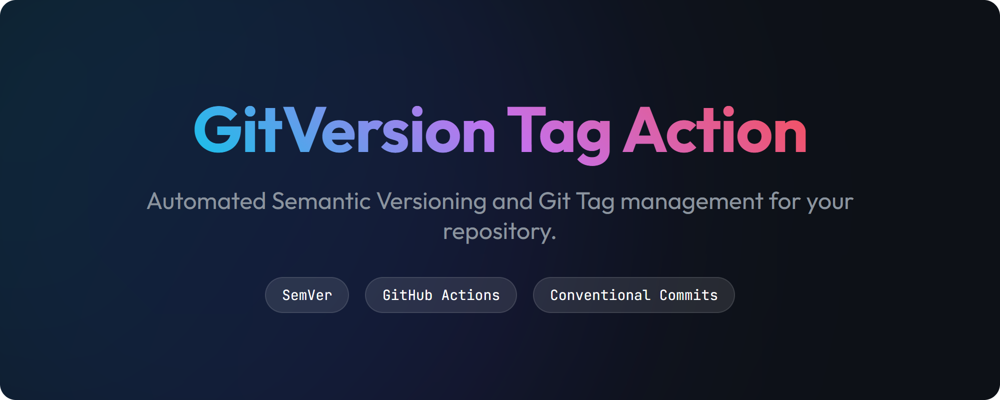

## 

## Overview

The **gitversion-tag-action** automates tagging your repository with a semantic version determined by [GitVersion](https://gitversion.net/), which analyzes your git history to calculate the next version based on your configuration.

## Inputs

| Input | Default | Description |
| --- | --- | --- |
| `configFilePath` | Empty | Custom GitVersion config path, relative to the caller's checkout or absolute. Empty uses the bundled config. |
| `prefix` | Empty | Tag prefix, for example `v`. Existing unprefixed tagging remains the default. |
| `dry-run` | `false` | Compute version outputs without creating or pushing tags. |
| `tagMessage` | Empty | Custom tag annotation. Empty uses the latest commit subject. |

## Outputs

`semVer` remains available for existing callers. The action also forwards every
version output declared by the pinned `gittools/actions/gitversion/execute`,
including `FullSemVer`, `InformationalVersion`, `Major`, `Minor`, `Patch`,
`MajorMinorPatch`, `PreReleaseTag`, `Sha`, `ShortSha`, and `VersionSourceDistance`.
See [action.yml](action.yml) for the complete list.

| Output | Description |
| --- | --- |
| `tagged` | `true` if this run pushed tags; otherwise `false`. |
| `pushed-tag` | Exact tag pushed, or empty if skipped. Includes the chosen prefix and prerelease label. |
| `pushed-tags` | All pushed tags, separated by spaces. |
| `skip-reason` | `dry-run`, `tag-exists`, or empty after a successful push. |

## Execution

The action follows these steps:

1. Select the config bundled with this action, or the explicitly supplied custom config. The action never copies a config into the caller's checkout.
2. Install the pinned GitVersion tool using `gittools/actions` and compute the version and all version outputs. The runner needs the .NET SDK required by the pinned tool; GitHub-hosted Ubuntu runners include it.
3. Unless `dry-run` is enabled, create an annotated exact tag and push only that ref. An exact tag already on the remote is a successful no-op. Existing exact tags are never force-updated.

The version tag identifies its commit. There is no separate SHA-named Git tag;
consumers can pin the underlying full commit SHA directly for an immutable
action or reusable-workflow reference.

## Shared Configuration

[gitversion.yml](gitversion.yml) is the central config shipped with the action.
Consumers need no config file unless they want different versioning rules. Pin
the action version to pin both its behavior and its config. The default recognizes
both prefixed (`v1.2.3`) and unprefixed (`1.2.3`) version tags.

| Commit | Increment |
| --- | --- |
| `feat!: ...`, `feat(scope)!: ...`, or an uppercase `BREAKING CHANGE:` / `BREAKING-CHANGE:` footer | Major |
| `feat: ...` or `feat(scope): ...` | Minor |
| `fix`, `chore`, `perf`, `refactor`, or `revert`, optionally scoped | Patch |
| `docs`, `style`, `test`, `ci`, and other non-breaking types | None |

The bundled configuration treats `chore`, including Renovate's `chore(deps)`
commits, as a patch increment so dependency updates produce a release.

All commits since the version source are evaluated. A documentation commit does
not suppress a preceding feature or breaking change. The main branch uses no
automatic increment; maintenance branches use `release/MAJOR.MINOR.PATCH`.

## Upgrade from v6

The `v7.0.0` line uses full semantic versions. Existing `v1` through `v6` tags
are preserved, and updating this action does not happen automatically for callers
pinned to them. There is no moving `v7` alias.

The default configuration changed from a caller-owned `gitversion.yml` to the
bundled rules. To keep your repository's existing versioning behavior when
upgrading, pass its config explicitly:

```yaml
with:
  configFilePath: gitversion.yml
```

Workflows already supplying `configFilePath` continue to use that file. Omit it
only when you want the bundled behavior. The default tag prefix is still empty.

## Example Workflow

To use the **Tag a git version** action in a GitHub workflow, refer to the example below:

> [!WARNING]
> For production, pin the full commit SHA of a reviewed release for immutable execution.

```yaml
name: GitVersion Tag

permissions:
  contents: write

on:
  push:
    branches: [ "main" ]
  workflow_dispatch:

jobs:
  build:
    runs-on: ubuntu-latest
    steps:
    - name: Checkout Step
      uses: actions/checkout@3d3c42e5aac5ba805825da76410c181273ba90b1 # v7.0.1
      with:
        fetch-depth: 0
        fetch-tags: true
    - name: Tag the repo
      id: gitversion
      uses: michielvha/gitversion-tag-action@2700bccb9cf4a84c9c021cd866f8d357c526fb27 # v7.0.1
```

To keep an existing custom config, pass `configFilePath: gitversion.yml` (or its
actual path). Explicit paths remain supported and missing files fail clearly.
Remove that input, or leave it empty, to adopt the bundled rules.
For pull-request builds, use `dry-run: 'true'` and `contents: read` permissions.

In this workflow:

- The action is triggered on pushes to the `main` branch and can also be manually triggered using the `workflow_dispatch` event.
- The repository is checked out with a fetch depth of 0, ensuring all tags and branches are fetched.
- The `semVer` is calculated using the bundled configuration and tagged together with the latest commit message.

It's possible to pass the version to other actions via the output.

```yaml
...
      - name: Build and Push Docker Image
        id: docker-build
        uses: michielvha/docker-release-action@e7bb601b3297b74c958e4f36fef697f28febbadc # v1
        with:
          version: ${{ steps.gitversion.outputs.semVer }}
...
```

### Reference
- [GitVersion Config File Specification](https://gitversion.net/docs/reference/configuration) - Complete reference for the configuration file. The bundled config is [here](gitversion.yml).
- [Metadata syntax for GitHub Actions](https://docs.github.com/en/actions/sharing-automations/creating-actions/metadata-syntax-for-github-actions)
